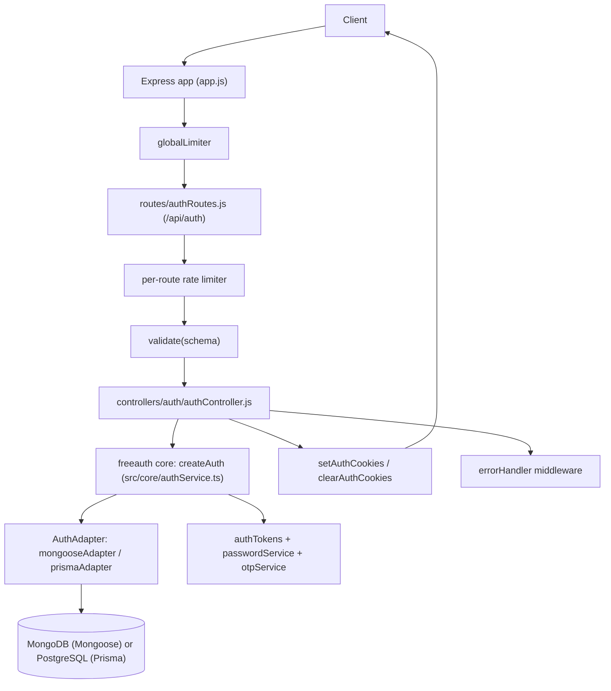
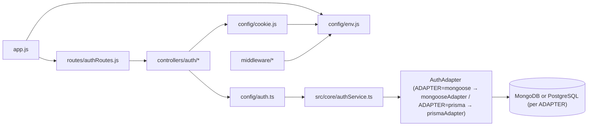

# Backend Reference — `freeauth` + Express Reference App

> Single source of truth for the backend as it **actually exists** in this repository.
> Audited directly from source. No invented endpoints, fields, env vars, or behaviors.
> Where something cannot be determined from the repo it is marked `Unknown / requires verification`.

## Table of Contents

1. [Backend Overview](#1-backend-overview)
2. [Project Structure](#2-project-structure)
3. [Architecture](#3-architecture)
4. [API Reference](#4-api-reference)
5. [Authentication](#5-authentication)
6. [Database](#6-database)
7. [Validation](#7-validation)
8. [Error Handling](#8-error-handling)
9. [Middleware](#9-middleware)
10. [Configuration & Environment Variables](#10-configuration--environment-variables)
11. [External Services](#11-external-services)
12. [Security](#12-security)
13. [Data Flow Examples](#13-data-flow-examples)
14. [Scripts & Development](#14-scripts--development)
15. [Deployment](#15-deployment)
16. [Testing](#16-testing)
17. [Dependencies](#17-dependencies)
18. [API Conventions](#18-api-conventions)
19. [Known Limitations / Technical Debt](#19-known-limitations--technical-debt)
20. [Glossary](#20-glossary)

---

## 1. Backend Overview

This repository contains **two things that ship together but serve different roles**:

| Part | Location | What it is |
|------|----------|------------|
| **A. `freeauth` library** | `src/` → built to `dist/` | Drop-in authentication library (OTP email verification, JWT access/refresh sessions with rotation + reuse detection, per-flow lockouts). Database-agnostic via an `AuthAdapter` interface. Not yet published to npm (v0.1.0, pre-publish; the `openauth` name on the registry belongs to an unrelated deprecated package, and `freeauth` was verified unclaimed). |
| **B. Express reference app** | `app.js`, `routes/`, `controllers/`, `middleware/`, `config/`, `model/`, `utils/` | Small runnable Express 5 app demonstrating one way to wire the library up. Adapter selection is explicit via `ADAPTER` env var — `mongoose` → MongoDB/Mongoose, `prisma` → PostgreSQL/Prisma (`PrismaPg` driver adapter). **Not** part of the published package (`package.json` `files` = `dist`, `README.md`, `LICENSE` only). |

### What the backend does

- User registration with email OTP verification.
- Login gated on verified email.
- JWT access (15 min) + refresh (7 day) sessions, stored server-side, rotated on every refresh, with reuse detection that wipes all user sessions.
- Forgot-password / reset-password via OTP.
- Resend verification OTP.
- Authenticated password change (revokes all sessions).
- Logout (revokes refresh token, clears cookies).
- `GET /me` current-user profile.
- Health/status probe (`GET /api/auth/`).

### Architectural style

- **Library (`src/`):** layered + adapter pattern. `core/authService.ts` holds 100% of business logic and talks **only** to the `AuthAdapter` interface (`src/core/types.ts`). `adapters/mongoose.ts` and `adapters/prisma.ts` translate that interface to Mongoose and Prisma respectively. `internal/` holds cross-cutting helpers (password hashing, OTP, JWT issuance, errors, logger, Mongoose models). The governing design doc is `doc/freeauth-architecture.md`.
- **Reference app:** thin Express adapter over the library. Route → rate limiter → Zod validation → controller → `auth.*` core method → adapter (selected by `ADAPTER` env var) → MongoDB or PostgreSQL → JSON response + cookies. No service/repository layer of its own; all domain logic lives in the library.

### Main technologies

Express `^5.2.1`, Mongoose `^9.4.1` (optional peer), `@prisma/client` `^7.10.0` (optional peer), `@prisma/adapter-pg` `^7.10.0` (driver adapter, dev), `jsonwebtoken` `^9.0.3`, `bcryptjs` `^3.0.3`, `zod` `^4.3.6`, `helmet` `^8.1.0`, `cors` `^2.8.6`, `cookie-parser` `^1.4.7`, `express-rate-limit` `^8.5.1`, `dotenv` `^17.4.1`, TypeScript `^7.0.2`, Vitest `^4.1.11` + `supertest` + `mongodb-memory-server` (tests).

### Major component interaction



Only components shown above exist. There is no caching layer, queue/worker, WebSocket server, file storage, mailer, or RBAC service.

### High-level request lifecycle

```text
Request
  → express.json()
  → helmet()
  → cors()
  → cookieParser()
  → globalLimiter
  → router (/api/auth/*)
  → per-route limiter (most POST routes)
  → validate(Zod schema) [body only; most POST routes]
  → authMiddleware [GET /me, POST /change-password only]
  → controller (asyncHandler wrapper)
  → auth.<method>() in src/core/authService.ts
  → adapter.users.* / adapter.sessions.* (mongooseAdapter → MongoDB or prismaAdapter → PostgreSQL, per ADAPTER env var)
  → MongoDB or PostgreSQL (per ADAPTER)
  → set/clear cookies + JSON response
  → (on throw) errorHandler → JSON error response
```

Implementation: `app.js`, `routes/authRoutes.js`, `middleware/*.js`, `controllers/auth/authController.js`, `config/auth.ts`, `src/core/authService.ts`.

---

## 2. Project Structure

```text
Authsystem/
├── app.js                          # Express entry point: middleware, routes, 404, error handler, DB connect + listen
├── config/
│   ├── env.js                      # Zod-validated env schema + parsed `env` export (single env source for app)
│   ├── cookie.js                   # accessCookieOptions / refreshCookieOptions (httpOnly, secure, sameSite, maxAge)
│   └── auth.ts                     # Composition root: createAuth({ adapter, secrets }) → `auth` — ADAPTER env var selects mongooseAdapter() or prismaAdapter(prisma)
├── routes/
│   └── authRoutes.js               # All 14 /api/auth routes (1 status + 13 auth ops), limiter + validation + controller wiring
├── controllers/
│   └── auth/
│       ├── authController.js       # 13 handlers; calls `auth.*`, sets/clears cookies, logs OTPs (dev stand-in for email)
│       └── authValidation.js       # Zod request schemas (register, login, forgot, reset, verify, resend, change)
├── middleware/
│   ├── authMiddleware.js           # Access-token check (cookie or Bearer header) → req.user = { userId }
│   ├── validate.js                 # Body-only Zod validator; replaces req.body with parsed data
│   ├── rateLimiter.js              # globalLimiter + 6 scoped limiters (express-rate-limit)
│   └── errorHandler.js             # Global error → JSON mapper (AppError, Zod, JWT, Mongoose); re-exports AppError
├── model/
│   └── mongodb.js                  # mongoose.connect(env.MONGODB_URL) → connectDB()
├── utils/
│   ├── cookies.js                  # setAuthCookies(res, access, refresh) / clearAuthCookies(res)
│   └── asyncHandler.js             # (fn) => (req,res,next) => Promise.resolve(fn(...)).catch(next)
├── src/                            # `freeauth` library source (built to dist/; the published package)
│   ├── core/
│   │   ├── authService.ts          # createAuth(): all 10 domain operations (register, login, verify, refresh, ...)
│   │   ├── types.ts                # AuthAdapter / UserAdapter / SessionAdapter / UserRecord / SessionRecord contracts
│   │   └── index.ts                # Public entry: createAuth + types (package `.` export → dist/core/index.js)
│   ├── adapters/
│   │   ├── mongoose.ts             # AuthAdapter over Mongoose models (used by reference app)
│   │   └── prisma.ts               # AuthAdapter over consumer-supplied Prisma client (PostgreSQL)
│   └── internal/
│       ├── authTokens.js           # generateAccessToken / generateRefreshToken (jsonwebtoken)
│       ├── passwordService.js      # bcryptjs hash (10 rounds) / verify
│       ├── otpService.js           # crypto.randomInt 6-digit OTP, sha256 hash, 10-min TTL issuance
│       ├── constants.js            # BCRYPT_ROUNDS, OTP_TTL_MS, ACCESS_TOKEN_TTL, REFRESH_TOKEN_TTL_MS
│       ├── errors.js               # AppError(message, statusCode, isOperational)
│       ├── logger.js               # Console logger (info/warn/error always; debug only in development)
│       └── models/
│           ├── userModel.js        # Mongoose User schema/model ("user")
│           └── refreshToken.js     # Mongoose RefreshToken schema/model ("RefreshToken")
├── prisma/
│   ├── schema.prisma               # Reference Prisma schema (PostgreSQL, User + RefreshToken); generator → generated/prisma
│   └── migrations/                 # Prisma migrations (init: User + RefreshToken tables)
├── prisma.config.ts                # Prisma 7 config: datasource url ← process.env.DATABASE_URL
├── generated/prisma/               # Prisma client output (generated; gitignored)
├── dist/                           # tsc build output of src/ (gitignored; what npm ships + what `freeauth/*` resolves to)
├── tests/                          # Vitest suite (unit core+adapters, express integration) — see §16
├── vitest.config.ts                # Vitest config: aliases `freeauth*` → live src/ (avoids stale dist), setupFiles, v8 coverage
├── doc/
│   └── freeauth-architecture.md    # Source of truth for core/adapter split + contracts + agent rules AND the focused API reference (§9–§10)
├── package.json / package-lock.json
├── tsconfig.json                   # Dev/typecheck config (noEmit, allowImportingTsExtensions, includes src + app dirs)
├── tsconfig.build.json             # Build config (extends base; declaration + outDir dist, include src only)
├── .env                            # Local secrets (gitignored in .gitignore but present in working tree — see §12/§19)
└── .gitignore                      # Ignores .env, node_modules, server.log, .gitignore(!), generated/, dist/
```

Notes:

- There is **no** `services/`, `repositories/`, `client/`, `frontend/`, `public/`, `Dockerfile`, `docker-compose.*`, or CI config. `tests/` **does** exist (a full Vitest suite — see §16). The old `repositories/*` referenced in comments were removed during the adapter refactor.
- The reference app consumes the library **as an installed package** (`import { mongooseAdapter } from 'freeauth/mongoose'` or `import { prismaAdapter } from 'freeauth/prisma'` per `ADAPTER`), which resolves via `node_modules/freeauth` (a `file:.` self-install) to `dist/`, not to `src/`. That means `npm run build` output must be fresh for app behavior to reflect `src/` changes (Vitest bypasses this with aliases — see §16).
- `controllers/auth/authController.js` imports `'../../config/auth.ts'` **with an explicit `.ts` extension** and `config/auth.ts` imports `'./env.js'` similarly. This relies on Node's native type-stripping (`allowImportingTsExtensions` in `tsconfig.json`); plain older Node setups without type-stripping support will fail to resolve these.

---

## 3. Architecture

### Separation of concerns

| Layer | Responsibility | May import |
|-------|----------------|------------|
| Routes (`routes/authRoutes.js`) | URL → middleware chain declaration only. No logic. | middleware, validation schemas, controllers |
| Controllers (`controllers/auth/authController.js`) | HTTP translation: read `req.body`/`req.cookies`/`req.user`, call one `auth.*` method, set/clear cookies, send JSON. OTP delivery stub (`logger.info`). No DB access, no hashing, no JWT. | `config/auth.ts`, `utils/cookies.js`, `utils/asyncHandler.js`, `src/internal/logger.js` |
| Core (`src/core/authService.ts`) | All auth decisions: existence checks, password verify, OTP verify/consume, lockouts, session rotation/reuse detection, token issuance, error throwing (`AppError`). | `internal/*` helpers + `adapter` param only. **Never** Mongoose/Prisma/models. |
| Adapters (`src/adapters/*.ts`) | Pure data access translating `AuthAdapter` calls to one ORM. | Their ORM + models/client only |
| Internals (`src/internal/*`) | Stateless crypto/logging primitives. | `jsonwebtoken`, `bcryptjs`, `crypto`, constants |
| Middleware | Cross-cutting HTTP concerns (auth, validation, rate limit, errors). | `jsonwebtoken`, `config/env.js`, `src/internal/errors.js` |

### Request lifecycle (concrete)

1. `app.js` builds Express app. Order is fixed: `express.json()` → `helmet()` → `cors({ origin: env.FRONTEND_URL, credentials: true })` → `cookieParser()` → `globalLimiter` → `authRoutes` at `/api/auth` → JSON 404 catcher → `errorHandler`.
2. Router chain per endpoint, e.g. register: `registerLimiter` → `validate(registerSchema)` → `registerUser`.
3. `validate` runs `schema.parse(req.body)`; on success **replaces** `req.body` with the parsed (stripped/typed) object; on `ZodError` calls `next(error)` → `errorHandler` → 422.
4. `authMiddleware` (only `GET /me`, `POST /change-password`) reads `req.cookies.accessToken` else `Authorization: Bearer <token>`, `jwt.verify(token, env.ACCESS_TOKEN_SECRET)`, sets `req.user = { userId: decoded.userId }`; failures get direct 401 JSON (never reach `errorHandler`).
5. Controller runs inside `asyncHandler` (promise rejections → `next(err)`). It calls exactly one `auth.*` core method, then `setAuthCookies`/`clearAuthCookies` where applicable, then `res.status(...).json({ success: true, ... })`.
6. Core performs adapter reads/writes, crypto, and throws `AppError` with precise `statusCode` on any business failure.
7. `errorHandler` maps the error to `{ success: false, message, [errors], [stack] }` with the status code.

### Dependency flow



Key rule (enforced by convention + `doc/freeauth-architecture.md` §6, not by tooling): **core never imports a DB driver/ORM/model**. Verified: `src/core/authService.ts` imports only `internal/*` helpers and `core/types.ts` types. The runtime edge is `ADAPTER=mongoose → mongoose.ts → src/internal/models/* → MongoDB` or `ADAPTER=prisma → prisma.ts → generated/prisma → PostgreSQL`, selected by `ADAPTER` env var.

### Controller/service responsibilities

There is no separate "service" layer in the Express app. `src/core/authService.ts` **is** the service layer, shared by any consumer of the library. Controllers are intentionally anemic (HTTP ↔ core translation). Consequence: business-rule bugs are fixed in `src/core/*`, HTTP-shape bugs in `controllers/*`/`middleware/*`.

### Database access pattern

Adapter pattern, not repository-per-entity files. Core calls `adapter.users.*` (13 methods) and `adapter.sessions.*` (4 methods) defined in `src/core/types.ts`. The runtime adapter is chosen once in `config/auth.ts` — `ADAPTER=mongoose` → `mongooseAdapter()` (Mongoose/MongoDB) or `ADAPTER=prisma` → `prismaAdapter(prisma)` (`PrismaClient` + `PrismaPg`, `DATABASE_URL`) — both equally supported production paths. Both adapters ship in the published package (`freeauth/mongoose`, `freeauth/prisma`).

### Validation strategy

Two independent Zod layers: (a) startup env validation (`config/env.js`, fail-fast `parse`), (b) per-request body validation (`controllers/auth/authValidation.js` + `middleware/validate.js`). No query/param validation exists (no endpoint uses query/path params). No validation inside core — core assumes the controller already validated shape but still defensively handles null users/OTPs.

### Error propagation

`AppError` thrown in core → `asyncHandler.catch(next)` → `errorHandler` (first branch) → status + message JSON. Zod/JWT/Mongoose errors map in later branches. `authMiddleware` short-circuits its own JWT failures with inline 401s. See §8.

### Middleware order (matters)

`express.json` must precede `validate` (needs parsed body); `cookieParser` must precede any `req.cookies` read (`refreshTokenController`, `logoutUser`, `authMiddleware`); `globalLimiter` precedes all routes; 404 catcher precedes `errorHandler` (Express error middleware must be last, 4-arg signature). Changing this order breaks auth flows.

### Authentication / authorization flows

Authentication = JWT access cookie/header + DB-backed refresh sessions; see §5. Authorization: **none** — there are no roles, permissions, or ownership checks anywhere. Any valid access token can call `GET /me` (returns self) and `POST /change-password` (changes self's password). No admin/user distinction exists.

### Inconsistencies (documented, not hidden)

- Mongoose `User.verifyOTPExpire`/`resetOTPExpire` default to `0` (Number) while the `UserRecord` contract and Prisma schema treat "absent" as `null`/`BigInt?`. `toUserRecord` uses `?? null`, so a fresh `0` passes through as `0`, not `null`.
- Mongoose `RefreshToken.token` is **not** unique; Prisma `RefreshToken.token` **is** `@unique`.
- Mongoose `User` schema has **no timestamps**; Mongoose `RefreshToken` has `timestamps: true`; Prisma `User` has `createdAt`+`updatedAt`, Prisma `RefreshToken` has only `createdAt`.
- Registration issues a session (cookies) **before** email verification, but login is blocked until verified — a newly registered (unverified) client holds usable cookies for 15 min / 7 days until expiry/revocation.
- `resetPasswordSchema` accepts both `password` and `newPassword` (one required), but the OpenAPI-style contract is ambiguous about which clients should send.

---

## 4. API Reference

Base path: router mounted at `/api/auth` in `app.js` (`app.use('/api/auth', authRoutes)`).
All paths below are full paths including that prefix.
No endpoint uses path parameters or query parameters (all inputs are JSON body and/or cookies/headers).
All JSON bodies require `Content-Type: application/json` (via `express.json()`).

Controllers: `controllers/auth/authController.js`. Core: `src/core/authService.ts` via `auth.*`.

#### Conventions used in this section

- **Auth:** `Public` = no token needed; `Access` = `authMiddleware` (cookie `accessToken` or `Authorization: Bearer <accessToken>`).
- **Limiter** column names the `express-rate-limit` instance applied in `routes/authRoutes.js` (`global` applies to everything on top).
- Error rows list only statuses the code can actually produce for that endpoint (traced through validation → core → errorHandler/middleware).

---

### `GET /api/auth/`

**Authentication:** Public. **Limiter:** global only. **Validation:** none.

**Purpose:** Liveness probe. Implementation: `getApiStatus` (`controllers/auth/authController.js:7`).

**Success — `200`:**

```json
{ "success": true, "message": "API is working" }
```

**Errors:** only `429` from `globalLimiter`.

---

### `POST /api/auth/register`

**Authentication:** Public. **Limiter:** global + `registerLimiter` (10/hr/IP). **Validation:** `registerSchema`.

**Request Body:**

```json
{ "name": "Ada Lovelace", "email": "ada@example.com", "password": "Str0ng!Pass" }
```

| Field | Rules (from `authValidation.js:12-27`) |
|-------|----------------------------------------|
| `name` | string, 2–50 chars, `/^[a-zA-Z\s]+$/`, trimmed length > 0 |
| `email` | valid email, 5–100 chars |
| `password` | 8–100 chars, ≥1 uppercase, ≥1 lowercase, ≥1 digit, ≥1 special (`[^A-Za-z0-9]`) |

**Flow:** `registerUser` → `auth.registerUser(body)` (409 if email exists; bcrypt-hash password; `issueOTP` verify OTP; `users.create`; issue access+refresh JWTs; `sessions.create`) → `setAuthCookies` → `logger.info("[DEV] Account verification OTP ...")`.

**Success — `201`:**

```json
{ "success": true, "message": "User registered successfully" }
```

Note: response does **not** contain tokens or OTP; both JWTs are Set-Cookie only, OTP goes to server log (no email is sent).

**Errors:**

| Status | Condition |
|--------|-----------|
| 422 | `registerSchema` fails (`{"success":false,"message":"Validation failed","errors":[{"field","message"}]}`) |
| 409 | Email already in use (`AppError` from core) |
| 429 | `registerLimiter` or `globalLimiter` |
| 500 | Unexpected (DB down, etc.) |

**Side effects:** creates `User` (unverified) + one `RefreshToken` session row; sets `accessToken` + `refreshToken` cookies.

---

### `POST /api/auth/login`

**Authentication:** Public. **Limiter:** global + `authLimiter` (5/15 min/IP). **Validation:** `loginSchema`.

**Request Body:**

```json
{ "email": "ada@example.com", "password": "Str0ng!Pass" }
```

| Field | Rules (`authValidation.js:29-39`) |
|-------|-----------------------------------|
| `email` | valid email, 5–100 chars |
| `password` | string, 1–100 chars (strength **not** re-checked at login) |

**Flow:** `loginUser` → `auth.loginUser` (401 if unknown email or wrong password — same message; 403 if `!isAccountVerified`; else issue token pair + `sessions.create`) → `setAuthCookies`.

**Success — `200`:**

```json
{ "success": true, "message": "Login successful" }
```

**Errors:**

| Status | Condition |
|--------|-----------|
| 422 | Body validation fails |
| 401 | Invalid email or password (intentionally identical for both cases) |
| 403 | Account exists but email not verified (`Please verify your email before logging in`) |
| 429 | `authLimiter` / global |
| 500 | Unexpected |

**Side effects:** creates one `RefreshToken` session row; sets both cookies (overwrites any previous pair; old sessions are **not** revoked — multi-device login accumulates sessions).

---

### `POST /api/auth/logout`

**Authentication:** Public (no middleware; works with or without cookies). **Limiter:** global only. **Validation:** none.

**Inputs:** `Cookie: refreshToken=<token>` if present (read via `req.cookies?.refreshToken`).

**Flow:** `logoutUser` → `auth.logoutUser(token)` (no-op success if missing; else `sessions.revoke(token)` — single atomic revoke, ignored return) → `clearAuthCookies` → 200. Logout never fails with 401 even for absent/invalid tokens.

**Success — `200`:**

```json
{ "success": true, "message": "Logout successful" }
```

**Errors:** `429` (global) or `500` only. **Side effects:** revokes that one refresh session (if supplied); clears both cookies.

---

### `POST /api/auth/refresh`

**Authentication:** Refresh-cookie holder (not `authMiddleware`). **Limiter:** global + `refreshLimiter` (20/15 min/IP). **Validation:** none (missing token handled in core).

**Inputs:** `Cookie: refreshToken=<token>` (required in practice).

**Flow:** `refreshTokenController` → `auth.refreshSession(cookie)` → `rotateSession`: `sessions.findValid(token)` (must exist **and** `expiresAt > now`; note revoked tokens still "found" — revocation is checked next), 401 if missing/revoked; `users.findById` (401 `User not found` if orphaned); **atomic** `sessions.revoke(oldToken)` — if it returns `false` (already revoked) → `revokeAllForUser` + `logger.warn("[SECURITY] Refresh token reuse detected...")` + 401 `Session invalidated due to suspicious activity, please login again`; else issue new pair + `sessions.create` → `setAuthCookies`.

**Success — `200`:**

```json
{ "success": true, "message": "Token refreshed successfully" }
```

New `accessToken` + `refreshToken` are delivered as Set-Cookie headers (rotation: old refresh token is revoked server-side).

**Errors:**

| Status | Condition |
|--------|-----------|
| 401 | No refresh token provided / Invalid or expired refresh token / Session invalidated (reuse) / User not found |
| 429 | `refreshLimiter` / global |
| 500 | Unexpected |

**Side effects:** revokes old session, creates new session row on every successful call.

---

### `GET /api/auth/me`

**Authentication:** Access (`authMiddleware`). **Limiter:** global only. **Validation:** none.

**Headers:** either `Cookie: accessToken=<jwt>` or `Authorization: Bearer <jwt>`.

**Flow:** `authMiddleware` → `req.user.userId` → `auth.getMe(userId)` → strips sensitive fields, returns safe projection.

**Success — `200`:**

```json
{
  "success": true,
  "data": { "id": "<string>", "email": "ada@example.com", "name": "Ada Lovelace", "isAccountVerified": true }
}
```

**Errors:**

| Status | Condition |
|--------|-----------|
| 401 | No access token provided / Access token expired / Invalid access token (from `authMiddleware`, inline JSON, not `errorHandler`) |
| 404 | User not found (token valid but user deleted) |
| 429 | global |
| 500 | Unexpected |

---

### `POST /api/auth/forgot-password`

**Authentication:** Public. **Limiter:** global + `resetPasswordLimiter` (5/30 min/IP, **shared** with reset). **Validation:** `forgotPasswordSchema` (`{ email }` only).

**Request Body:** `{ "email": "ada@example.com" }`

**Flow:** `forgotPassword` → `auth.forgotPassword` (returns `{ sent:false }` for unknown email — no error; else `issueOTP` reset OTP + `users.setResetOTP` → `{ sent:true, otp }`) → if sent, `logger.info("[DEV] Password reset OTP ...")` → always the same 200 message (enumeration-resistant).

**Success — `200` (both cases):**

```json
{ "success": true, "message": "If this email exists, an OTP has been sent" }
```

**Errors:** `422` (bad email shape), `429` (shared limiter), `500`. Never 404/401 for unknown email by design.

---

### `POST /api/auth/reset-password`

**Authentication:** Public. **Limiter:** global + `resetPasswordLimiter` (shared 5/30 min). **Validation:** `resetPasswordSchema`.

**Request Body (preferred):**

```json
{ "email": "ada@example.com", "otp": "123456", "newPassword": "N3w!Strong1" }
```

Legacy alias also accepted: `"password"` instead of `"newPassword"` (at least one required; if both sent, `newPassword` wins — `data.newPassword ?? data.password` in `authService.ts:461`).

| Field | Rules (`authValidation.js:45-53`) |
|-------|-----------------------------------|
| `email` | valid email |
| `otp` | string, exactly 6 chars, all digits |
| `newPassword` / `password` | optional individually, but refine requires ≥1; each follows full strength `passwordSchema` when present |

**Flow:** `auth.resetPassword` → lookup → `verifyAndConsumeOTP(user, otp, 'reset')` (400 invalid/expired/locked paths; clears OTP + resets attempts on success) → bcrypt-hash new password → `users.updatePassword` → `revokeAllForUser` (logs out everywhere).

**Success — `200`:** `{ "success": true, "message": "Password reset successful" }`

**Errors:**

| Status | Condition |
|--------|-----------|
| 422 | Validation fails (incl. missing both password fields, weak password, malformed OTP) |
| 400 | Invalid or expired OTP |
| 429 | Per-flow OTP lockout (`Too many attempts, try again later`) **or** HTTP rate limiter |
| 500 | Unexpected |

**Side effects:** password changed; **all** refresh sessions revoked.

---

### `POST /api/auth/verify-email`

**Authentication:** Public. **Limiter:** global + `verifyEmailLimiter` (5/15 min). **Validation:** `verifyEmailSchema` (`email` + 6-digit `otp`).

**Request Body:** `{ "email": "ada@example.com", "otp": "123456" }`

**Flow:** `auth.verifyEmail` → `verifyAndConsumeOTP(user, otp, 'verify')` → `markVerified` + `clearVerifyOTP` + `resetOtpAttempts` on success.

**Success — `200`:** `{ "success": true, "message": "Email verified successfully" }`

**Errors:** same shape as reset-password: `422` validation, `400` invalid/expired OTP, `429` lockout/limiter, `500`.

---

### `POST /api/auth/resend-otp`

**Authentication:** Public. **Limiter:** global + `resendOtpLimiter` (5/30 min). **Validation:** `resendOTPSchema` (`{ email }`).

**Request Body:** `{ "email": "ada@example.com" }`

**Flow:** `auth.resendOTP` → `{ sent:false }` for unknown email (same generic 200); 400 `Account is already verified` if verified; else `issueOTP` + `setVerifyOTP` → log OTP → generic 200.

**Success — `200`:** `{ "success": true, "message": "If this email exists, a new OTP has been sent" }`

**Errors:**

| Status | Condition |
|--------|-----------|
| 422 | bad email |
| 400 | Account is already verified |
| 429 | limiter |
| 500 | Unexpected |

---

### `POST /api/auth/change-password`

**Authentication:** Access (`authMiddleware`). **Limiter:** global only (no dedicated limiter). **Validation:** `changePasswordSchema`.

**Request Body:** `{ "currentPassword": "<old>", "newPassword": "<new-strong>" }`

| Field | Rules (`authValidation.js:55-61`) |
|-------|-----------------------------------|
| `currentPassword` | non-empty string |
| `newPassword` | full strength `passwordSchema`; must differ from `currentPassword` (refine) |

**Flow:** `auth.changePassword(req.user.userId, body)` → 404 if user gone; 401 `Current password is incorrect` if mismatch; else hash + `updatePassword` + `revokeAllForUser` (including the caller's own session — client must re-login).

**Success — `200`:** `{ "success": true, "message": "Password changed successfully" }`

**Errors:**

| Status | Condition |
|--------|-----------|
| 401 | No/invalid/expired access token (middleware) **or** current password incorrect (core) **or** OAuth-only account attempting password change (core `This account uses social sign-in...`) |
| 422 | Validation (weak new password, same-as-current, missing fields) |
| 404 | User not found |
| 429 | global |
| 500 | Unexpected |

---

### `POST /api/auth/google`

**Authentication:** Public. **Limiter:** global + `authLimiter` (shared 5/15 min/IP login bucket — see note below). **Validation:** `googleLoginSchema` (`{ idToken }`).

**Request Body:**

```json
{ "idToken": "<google-id-token-jwt>" }
```

| Field | Rules (`authValidation.js`) |
|-------|-----------------------------|
| `idToken` | non-empty string (signature/expiry/audience verified server-side by `google-auth-library`, not by the schema) |

**Flow:** `googleLogin` → `auth.loginWithGoogle(idToken)` (500 if Google sign-in unconfigured; 401 if token invalid/expired or payload lacks email/`sub`; 403 if `email_verified` is not `true`; 409 if the email already exists **regardless of provider** — never linked; else `createOAuthUser` verified + `issueSession`) → `setAuthCookies`.

**Success — `200`:**

```json
{ "success": true, "message": "Google login successful", "isNewUser": true }
```

`isNewUser` is always `true` on this endpoint today (any pre-existing email is rejected rather than logged in, so a 200 implies a freshly created OAuth account). The frontend can use it for "welcome" vs "welcome back" copy if a returning-OAuth-user path is added later; both JWTs arrive as Set-Cookie headers exactly like password login.

**Errors:**

| Status | Condition |
|--------|-----------|
| 422 | Missing/empty `idToken` |
| 401 | Invalid or expired Google ID token |
| 403 | Google account email is not verified |
| 409 | An account already exists with this email (sign in with password instead — no linking) |
| 429 | `authLimiter` (shared with `/login`, `/github`) / global |
| 500 | Google sign-in not configured (`GOOGLE_CLIENT_ID` unset) or unexpected |

**Side effects:** creates `User` (`provider: 'google'`, verified, no password) on first use + one `RefreshToken` session row; sets both cookies.

---

### `POST /api/auth/github/state`

**Authentication:** Public. **Limiter:** global + `authLimiter` (shared 5/15 min/IP login bucket — initiation is part of the login surface). **Validation:** none (no body).

**Flow:** `githubOAuthState` → generates 32 random bytes (hex) → sets them as the short-lived httpOnly `github_oauth_state` cookie → returns the value for the authorize URL. No user lookup, no session.

**Success — `200`:**

```json
{ "success": true, "data": { "state": "<64-hex-chars>" } }
```

**Errors:**

| Status | Condition |
|--------|-----------|
| 429 | `authLimiter` (shared with `/login`, `/google`, `/github`) / global |
| 500 | Unexpected |

**Side effects:** sets `github_oauth_state` cookie (10 min, overwritten on repeat calls).

---

### `POST /api/auth/github`

**Authentication:** Public. **Limiter:** global + `authLimiter` (shared 5/15 min/IP login bucket). **Validation:** `githubLoginSchema` (`{ code, state }`).

**Request Body:**

```json
{ "code": "<github-oauth-authorization-code>", "state": "<echoed-state-from-github-redirect>" }
```

| Field | Rules (`authValidation.js`) |
|-------|-----------------------------|
| `code` | non-empty string (single-use; exchanged server-side, never verified locally) |
| `state` | non-empty string (must match the value issued by `POST /github/state`; compared server-side before any code exchange) |

**Flow:** `githubLogin` → consumes (clears) the `github_oauth_state` cookie → `auth.loginWithGithub(code, state, expectedState)` (500 if GitHub sign-in unconfigured; 401 if `state` missing/mismatched — checked first, before any GitHub call — or code invalid/expired or profile fetch fails; 403 if no `primary && verified` email; 409 if the email already exists regardless of provider; else `createOAuthUser` with GitHub numeric user id as `providerId` + `issueSession`) → `setAuthCookies`.

**Success — `200`:**

```json
{ "success": true, "message": "GitHub login successful", "isNewUser": true }
```

Same `isNewUser` semantics and cookie delivery as `/google`.

**Errors:**

| Status | Condition |
|--------|-----------|
| 422 | Missing/empty `code` or `state` |
| 401 | Invalid OAuth state (missing/mismatched — retry from `POST /github/state`), invalid or expired authorization code, or GitHub profile fetch failed |
| 403 | GitHub account has no verified primary email |
| 409 | An account already exists with this email (sign in with password instead — no linking) |
| 429 | `authLimiter` (shared with `/login`, `/google`) / global |
| 500 | GitHub sign-in not configured (`GITHUB_CLIENT_ID`/`GITHUB_CLIENT_SECRET` unset) or unexpected |

**Side effects:** creates `User` (`provider: 'github'`, verified, no password) on first use + one session row; sets both cookies; consumes the state cookie (single-use — every attempt needs a fresh `POST /github/state`).

**Limiter note:** `/login`, `/google`, `/github`, and `/github/state` share one `authLimiter` instance (5/15 min/IP), matching the existing convention where `/forgot-password` + `/reset-password` share `resetPasswordLimiter`. Rationale: all four exchange a credential (or mint login CSRF material) for a session, so separate buckets would multiply an attacker's attempt budget; tradeoff is that heavy alternating use across surfaces consumes one budget.

**Endpoint count: 14** (1 status + 13 auth operations).

---

## 5. Authentication

Implementation: `src/core/authService.ts` (12 methods), `src/internal/authTokens.js`, `src/internal/passwordService.js`, `src/internal/otpService.js`, `src/internal/constants.js`, `middleware/authMiddleware.js`, `config/cookie.js`, `utils/cookies.js`, composition in `config/auth.ts`.

### Registration

`POST /api/auth/register` → `auth.registerUser({ name, email, password })` (`authService.ts:209-240`): duplicate-email check (409 `Email already in use`); `hashPassword`; `issueOTP(null,'verify')`; `users.create` (stores **hashed** OTP + expiry); issue JWT pair; `sessions.create`; return `{ accessToken, refreshToken, otp }` to controller (OTP logged, tokens set as cookies). Account starts `isAccountVerified=false`.

### Login

`auth.loginUser` (`authService.ts:242-276`): find by email → 401 `Invalid email or password` if missing; 401 provider-neutral `This account uses social sign-in...` if the account has no password hash (OAuth-only accounts are rejected before `bcrypt.compare`); `verifyPassword` → same 401 on mismatch (no user-enumeration oracle); 403 `Please verify your email before logging in` if unverified; else token pair + session row. Strength rules are **not** re-evaluated at login (`loginSchema` only requires non-empty password).

### Social sign-in (Google / GitHub) — frontend integration note

OAuth accounts (`provider: 'google' | 'github'`, `password: null`, `isAccountVerified: true` from creation) authenticate without passwords and never touch the OTP flow. The two providers integrate **differently on the frontend**, and the buttons must be built accordingly:

- **Google (`POST /api/auth/google`, body `{ idToken }`):** the frontend obtains a Google **ID token JWT client-side** via Google Identity Services (GIS button/popup → `credential` response), then POSTs it. No redirect, no server-side secret involved in the browser step. The backend verifies signature/expiry/audience with `google-auth-library` and checks the `email_verified` claim.
- **GitHub (3 steps — `state` is mandatory, not optional):** (1) `POST /api/auth/github/state` → `{ state }` (also sets the `github_oauth_state` cookie); (2) **redirect** the user to `https://github.com/login/oauth/authorize?client_id=<GITHUB_CLIENT_ID>&scope=user:email&state=<state>` — the `state` query param is required, it is what stops an attacker fixating the victim's session onto the attacker's account; (3) after authorization GitHub redirects back with single-use `code` **and** the echoed `state` query params — extract **both** (use GitHub's echoed `state`, never a stored copy) and `POST /api/auth/github` with `{ code, state }`. The backend consumes the cookie and rejects mismatches with 401 before any code exchange. The backend exchanges the code for an access token (using `GITHUB_CLIENT_SECRET`, which never leaves the server), fetches profile + emails, and requires a `primary && verified` email.

Common behavior afterwards: both endpoints set the standard `accessToken`/`refreshToken` cookies (same flags/lifetimes as password login — see Cookies below), return `isNewUser` (`true` today, since any pre-existing email is rejected with 409 `An account already exists with this email...` instead of being linked — there is intentionally no auto-linking), and create at most one session row per call. OAuth users calling password endpoints get clean errors, not crashes: `POST /login` → 401 social-sign-in message, `POST /change-password` → same 401. If `GOOGLE_CLIENT_ID` / `GITHUB_CLIENT_ID`+`GITHUB_CLIENT_SECRET` are unset, the corresponding endpoint returns 500 `... sign-in is not configured` (by design — unconfigured providers fail at call time, not at app boot).

### Logout

`auth.logoutUser(token)` (`authService.ts:526-534`): falsy token → `{ loggedOut: true }` immediately; else atomic `sessions.revoke(token)` (return ignored — double logout still succeeds). Controller always `clearAuthCookies`.

### Token generation & structure

`src/internal/authTokens.js`:

```js
generateAccessToken(user, secret)  // jwt.sign({ userId: user.id }, secret, { expiresIn: '15m' })
generateRefreshToken(user, secret) // jwt.sign({ userId: user.id }, secret, { expiresIn: 604800 }) // 7d in seconds
```

- Payload is exactly `{ userId: <string>, iat: <s>, exp: <s> }` — no email, name, role, or token id (`jti`). Verified in `authMiddleware.js:15` (`decoded.userId`) and passed as `{ id: userId }` during rotation (`authService.ts:122-123`).
- Algorithms: `jsonwebtoken` default `HS256` (not overridden anywhere).
- Secrets come from validated env via `config/auth.ts` (`ACCESS_TOKEN_SECRET` / `REFRESH_TOKEN_SECRET`, must differ, ≥32 chars). Library never reads `process.env` for secrets.

### Token storage

- **Access token:** stateless; **not** stored server-side. Accepted from `accessToken` cookie first, else `Authorization: Bearer` header. Revocation is not possible except by waiting ≤15 min for expiry.
- **Refresh token:** stateful; JWT **plus** a DB row (`RefreshToken` / `refreshToken`) holding the literal token string, `userId`, `expiresAt` (+7 d), `isRevoked`. Every refresh/logout/password-change mutates these rows. `findValid` enforces `expiresAt > now` at query time; MongoDB additionally has a TTL index (`expires: '0'`, i.e. expire exactly at `expiresAt`).

### Refresh, rotation, reuse detection

`rotateSession` (`authService.ts:111-144`): find valid → owner lookup → **atomic** `revoke(oldToken)` → on `false` (already revoked ⇒ reuse/replay) revoke **all** user sessions, `logger.warn('[SECURITY] Refresh token reuse detected...')`, throw 401 `Session invalidated due to suspicious activity, please login again` → else mint fresh pair + create new session. Rotation happens on **every** successful `POST /refresh`, so a refresh token is single-use.

### Cookies

Defined in `config/cookie.js`, applied in `utils/cookies.js`:

| Cookie | maxAge | httpOnly | secure | sameSite | Set on | Cleared on |
|--------|--------|----------|--------|----------|--------|------------|
| `accessToken` | 15 min (`15*60*1000`) | `true` | `env.NODE_ENV==='production'` only | `strict` | register, login, google, github, refresh | logout |
| `refreshToken` | 7 days (`7*24*60*60*1000`) | `true` | same | `strict` | register, login, google, github, refresh | logout |
| `github_oauth_state` | 10 min (`10*60*1000`) | `true` | same | `strict` | `POST /github/state` | consumed by `POST /github` (single-use), overwritten on re-issue |

`clearAuthCookies` passes the **same** options objects to `res.clearCookie`, so `Path`/`SameSite`/`Secure` match for proper removal. Cookie `Path`/`Domain` are never set (defaults apply). No `partitioned`, no `__Host-` prefix.

### Sessions

Multiple concurrent sessions per user are normal (each login/registration adds a row; only the used refresh token rotates). Full logout-everywhere happens on password reset, password change, and reuse detection — never on plain login/logout.

### Password hashing

`bcryptjs` with `BCRYPT_ROUNDS = 10` (`src/internal/constants.js:1`). `hashPassword` on register/reset/change; `verifyPassword` (constant-time `compare`) on login/change. Plaintext passwords never touch the database; hashes are never returned by `getMe` (core projects only `{ id, email, name, isAccountVerified }`).

### OTP / email verification

- Generation: `crypto.randomInt(100000, 1000000).toString()` — always 6 digits, no leading-zero edge (min 100000). Storage: `sha256` hex digest (`hashOTP`), never plaintext. TTL: `OTP_TTL_MS = 10 min`; `verifyOTPExpire`/`resetOTPExpire` stored as epoch-ms numbers (Mongoose) / `BigInt` (Prisma, converted with `Number()` on read).
- Verify flow (`verify` OTP): set at registration, refreshed by resend. `verifyAndConsumeOTP(..., 'verify')` checks lock → expiry (clears + 400 if past) → hash compare (increments attempts + 400 on mismatch) → `markVerified` + `clearVerifyOTP` + `resetOtpAttempts` on success.
- Reset flow (`reset` OTP): set by forgot-password, consumed by reset-password; success clears reset OTP + resets attempts, then password update + `revokeAllForUser`.
- Attempt counting: `MAX_OTP_ATTEMPTS = 5`, `OTP_LOCKOUT_MS = 15 min`, tracked **separately** per flow (`verifyAttempts`/`verifyLockUntil` vs `resetAttempts`/`resetLockUntil`). Increment is atomic (`$inc` / Prisma `increment`) and the **post-increment return value** decides lockout — concurrent submissions cannot both slip under the threshold. Reaching 5 sets the lock and resets the counter (so after lock expiry the attacker gets 5 fresh tries, not immediate re-lock).
- Delivery: **none implemented**. `registerUser`/`forgotPassword`/`resendOTP` return raw `otp` to the controller, which `logger.info`s it (`[DEV] ... OTP for <email>: <otp>`). See §11.

### Password reset

Forgot (always-200, enumeration-resistant) → user reads OTP from server log (dev) → reset with OTP + new password → all sessions revoked. Unknown email yields `{ sent:false }` internally but identical HTTP 200. Expired/used OTP yields 400 `Invalid or expired OTP`; locked flow yields 429.

### Token expiration

Access 15 min; refresh 7 days (JWT `exp` **and** DB `expiresAt` must both be valid). Expiry responses: access → 401 `Access token expired` (middleware) / `Token expired` (errorHandler fallback); refresh → 401 `Invalid or expired refresh token` (covers both revoked and DB-expired; JWT `exp` of the refresh token itself is **never verified** — `rotateSession` does not `jwt.verify` the refresh JWT, it only looks it up in the DB).

### Token rotation

Every successful refresh revokes the presented token and mints a new pair (see above). There is no "sliding window without rotation" mode and no refresh-token reuse grace period — immediate reuse triggers the wipe-all-sessions alarm path.

### Authentication middleware

`middleware/authMiddleware.js` (synchronous, self-contained): cookie-first, header-fallback; `jwt.verify` against `ACCESS_TOKEN_SECRET` only; sets `req.user = { userId }` (string). Used on exactly two routes: `GET /me`, `POST /change-password`. All other routes needing continuity use the refresh cookie directly in their controller.

### Authorization middleware / RBAC

None exists. No roles, permissions, ownership checks, or admin guards anywhere in the codebase (`grep` for `role|permission|admin|authorize` hits only comments/docs, not logic). `Unknown / requires verification` is not needed here — absence was verified by reading every route, controller, middleware, and core method.

### Complete lifecycle (happy path)

```text
register (unverified + cookies) → verify-email (OTP) → login (verified check passes)
  → access cookie authorizes /me + /change-password for 15 min
  → refresh rotates pair every ≤7 d (single-use)
  → forgot/reset or change-password revokes all sessions
  → logout revokes current refresh session + clears cookies
google/github login (verified-at-creation + cookies, isNewUser: true)
  → same cookies/sessions as password login; pre-existing email → 409, never linked
```

---

## 6. Database

### Technology & connection

- **Runtime database:** selected by `ADAPTER` env var — `ADAPTER=mongoose` → MongoDB (Atlas-style URL, `mongooseAdapter()`), `ADAPTER=prisma` → PostgreSQL (`prismaAdapter(prisma)` + `PrismaPg` adapter against `env.DATABASE_URL`). Both paths are equally supported production shapes; the same logical rows are exposed via whichever adapter is selected.
- **Connection handling:** `model/mongodb.js` (`connectDB`) opens a single shared Mongoose connection (`mongoose.connect(env.MONGODB_URL)`) **only when `ADAPTER=mongoose`** — `app.js` gates the call (`if (env.ADAPTER === 'mongoose') await connectDB()`), so no unused Mongo connection is opened under Prisma. Prisma needs no boot-time connect: the `PrismaClient` + `PrismaPg` pool connects lazily on first query (verified — `$connect` is optional; the driver adapter's pg Pool establishes connections on demand). No pooling tuning, retry, DB health endpoint, or disconnect handling exists for either path.
- **ORM/query layer:** Mongoose models in `src/internal/models/*` are accessed **only** through `src/adapters/mongoose.ts` (never directly from controllers/core); Prisma rows are accessed **only** through `src/adapters/prisma.ts` via the generated client. Tests are the exception: `tests/helpers/dbSetup.ts` writes to the Mongoose models directly to seed OTPs (used only by the `mongodb-memory-server` integration suites).
- **Migrations / client:** `prisma/migrations/20260915121515_init/` creates both tables; `prisma.config.ts` feeds `process.env.DATABASE_URL` to the Prisma CLI, `postinstall: prisma generate` regenerates `generated/prisma`, and the runtime client gets the same URL through the `PrismaPg` adapter when `ADAPTER=prisma`.

### Models

Two entities in both stores: `User` and `RefreshToken`/`Session`. No other collections/tables. No migrations for Mongoose (schema-on-write); Prisma reference schema is declarative (`prisma/schema.prisma`).

#### Mongoose — `user` (`src/internal/models/userModel.js`)

```text
user (collection derived from model name "user")
├── _id: ObjectId (implicit)
├── name: String, required
├── email: String, required, unique
├── password: String (bcrypt hash) | null, default null   ← NOT required (null for OAuth-only users)
├── provider: String, enum ['local','google','github'], default 'local'
├── providerId: String | null, default null               ← OAuth subject id (Google `sub` / GitHub numeric id)
├── verifyOTP: String (sha256 hex) | null, default null
├── verifyOTPExpire: Number (epoch ms), default 0        ← note: 0, not null
├── isAccountVerified: Boolean, default false
├── resetOTP: String | null, default null
├── resetOTPExpire: Number (epoch ms), default 0         ← note: 0, not null
├── verifyAttempts: Number, default 0
├── verifyLockUntil: Date | null, default null
├── resetAttempts: Number, default 0
└── resetLockUntil: Date | null, default null
```

No `timestamps`, no other indexes beyond the `unique` on `email`, no validators beyond `required`, no refs out of this model.

#### Mongoose — `RefreshToken` (`src/internal/models/refreshToken.js`)

```text
RefreshToken
├── _id: ObjectId (implicit)
├── userId: ObjectId, ref 'user', required
├── token: String (full refresh JWT), required           ← not unique
├── expiresAt: Date, required, index { expires: '0' }    ← TTL: Mongo deletes at expiresAt
├── isRevoked: Boolean, default false
├── createdAt: Date (timestamps:true)
└── updatedAt: Date (timestamps:true)
```

TTL semantics: `index: { expires: '0' }` means the MongoDB TTL monitor removes the document when `expiresAt` passes (with the usual ~60 s monitor granularity). Revoked-but-unexpired rows persist until their own `expiresAt`.

#### Prisma reference — `User` + `RefreshToken` (`prisma/schema.prisma`)

```prisma
model User {
  id                String    @id @default(cuid())
  name              String
  email             String    @unique
  password          String?
  isAccountVerified Boolean   @default(false)
  provider          String    @default("local")
  providerId        String?
  verifyOTP         String?
  verifyOTPExpire   BigInt?
  verifyAttempts    Int       @default(0)
  verifyLockUntil   DateTime?
  resetOTP          String?
  resetOTPExpire    BigInt?
  resetAttempts     Int       @default(0)
  resetLockUntil    DateTime?
  createdAt         DateTime  @default(now())
  updatedAt         DateTime  @updatedAt
}

model RefreshToken {
  id        String   @id @default(cuid())
  userId    String
  token     String   @unique
  isRevoked Boolean  @default(false)
  expiresAt DateTime
  createdAt DateTime @default(now())
}
```

Provider `postgresql`; Prisma 7 style (no `url` in `datasource`, `provider = "prisma-client"`, output `../generated/prisma`). The connection string lives outside the schema: `prisma.config.ts` reads `process.env.DATABASE_URL` for CLI operations, and the runtime client gets it via the `PrismaPg` driver adapter in `config/auth.ts`. `password` is nullable (OAuth-only users) and a `provider` column (`default "local"`) plus nullable `providerId` mirror the Mongoose OAuth fields. No `@relation` between `RefreshToken.userId` and `User.id` (plain string, no FK, no cascade, no `onDelete`).

### Contract shapes (`src/core/types.ts`)

Adapters normalize both stores to:

```ts
UserRecord { id: string; email; name; password: string|null; isAccountVerified: boolean;
  provider: 'local'|'google'|'github'; providerId: string|null;
  verifyOTP: string|null; verifyOTPExpire: number|null;
  verifyAttempts: number; verifyLockUntil: Date|null;
  resetOTP: string|null; resetOTPExpire: number|null;
  resetAttempts: number; resetLockUntil: Date|null; }
SessionRecord { userId: string; token: string; isRevoked: boolean; expiresAt: Date; createdAt: Date; }
```

Mongoose mapping stringifies `_id`/`userId`; Prisma mapping passes `id` through and `Number()`-converts `BigInt` expiries (lossless for epoch-ms, documented in `prisma.ts:9-12`).

### Fields / types / defaults / constraints summary

| Store | Entity | Required | Defaults | Unique | Indexes |
|-------|--------|----------|----------|--------|---------|
| Mongoose | user | name, email (password NOT required — null for OAuth) | OTP nulls, expiries `0`, verified `false`, counters `0`, locks `null`, provider `'local'`, providerId `null` | email | email unique only |
| Mongoose | RefreshToken | userId, token, expiresAt | isRevoked `false` | none | TTL on expiresAt |
| Prisma | User | name, email (password + providerId nullable) | verified `false`, counters `0`, provider `"local"`, createdAt/updatedAt | email | PK id, unique email |
| Prisma | RefreshToken | userId, token, expiresAt | isRevoked `false`, createdAt now | token | PK id, unique token |

### Relationships

One `User` → many `RefreshToken` via `userId` (logical only; Mongoose declares `ref: 'user'` enabling `populate`, but `populate` is never called; Prisma declares no relation at all). No cascading: deleting a user leaves orphaned session rows (and `rotateSession` then fails with 401 `User not found` rather than cleaning them).

### ER diagram

```mermaid
erDiagram
    User ||--o{ RefreshToken : "has many (userId, no FK cascade)"
    User {
        string id PK
        string email UK
        string name
        string password_hash "nullable"
        string provider "local | google | github"
        string providerId "nullable"
        boolean isAccountVerified
        string verifyOTP_hash "nullable"
        number verifyOTPExpire "epoch ms, nullable"
        int verifyAttempts
        date verifyLockUntil "nullable"
        string resetOTP_hash "nullable"
        number resetOTPExpire "epoch ms, nullable"
        int resetAttempts
        date resetLockUntil "nullable"
    }
    RefreshToken {
        string id PK
        string userId FK_logical
        string token "Mongoose: non-unique; Prisma: unique"
        boolean isRevoked
        date expiresAt "TTL in Mongoose"
    }
```

### Important queries (Mongoose adapter, `src/adapters/mongoose.ts`)

- `findByEmail`: `findOne({ email })` — exact, case-sensitive (no collation, no lowercasing).
- `findById`: `findById(id)` — throws `CastError` on malformed ObjectId (surfaced as 400 by `errorHandler`).
- `incrementOtpAttempts`: `findByIdAndUpdate(id, { $inc: { <flow>Attempts: 1 } }, { new: true })` — atomic, returns post-increment count.
- `findValid(token)`: `findOne({ token, expiresAt: { $gt: new Date() } })` — expiry enforced in query; revocation checked afterwards in core.
- `revoke(token)`: `findOneAndUpdate({ token, isRevoked: false }, { isRevoked: true })` — single atomic op; `null` result ⇒ already revoked ⇒ reuse path.
- `revokeAllForUser(userId)`: `updateMany({ userId }, { isRevoked: true })`.
- Prisma equivalents use `findUnique`/`findFirst`/`create`/`update`/`updateMany({ where: { token, isRevoked: false } })` with `count`-based reuse detection (`prisma.ts:208-214`).

### Transactions

None. Multi-write flows (e.g. `markVerified` + `clearVerifyOTP` + `resetOtpAttempts`; password update + `revokeAllForUser`) are sequential awaits with no session/transaction — partial failure leaves intermediate state (see §19).

### Timestamps / soft deletion

No soft deletion anywhere. Timestamps only on Mongoose `RefreshToken` (and both Prisma models); Mongoose `User` has neither `createdAt` nor `updatedAt`.

---

## 7. Validation

- **Library:** `zod` `^4.3.6`.
- **Where it happens:** exclusively at the HTTP boundary. `routes/authRoutes.js` attaches `validate(schema)` to 9 of 13 routes (all body-taking POSTs except logout/refresh, which take no validated body, and `/github/state`, whose empty body needs none). Core performs no schema validation — it trusts the controller's shape and handles semantic failures (unknown user, bad OTP) with `AppError`.
- **What is validated:** request **body only**. `middleware/validate.js` runs `schema.parse(req.body)` and replaces `req.body` with the result. Query strings, path params, cookies, and headers are never schema-validated (no endpoint needs query/params; cookies/headers are checked imperatively).
- **Error format:** `ZodError` → `next(error)` → `errorHandler` 422:

```json
{
  "success": false,
  "message": "Validation failed",
  "errors": [{ "field": "password", "message": "Password must contain at least one number" }]
}
```

`field` is `issue.path.join('.')` (empty string for form-level `refine` failures on the object itself, dotted for field-level).

### Actual request schemas (`controllers/auth/authValidation.js`)

Shared `passwordSchema`: string, 8–100 chars, each of `[A-Z]`, `[a-z]`, `[0-9]`, `[^A-Za-z0-9]` required.

| Schema (route) | Fields & rules |
|----------------|----------------|
| `registerSchema` (register) | `name`: 2–50 chars, letters+spaces only, non-blank after trim; `email`: email, 5–100; `password`: `passwordSchema` |
| `loginSchema` (login) | `email`: email, 5–100; `password`: 1–100 (any content) |
| `forgotPasswordSchema` | `email`: email (no length bounds) |
| `resetPasswordSchema` | `email`: email; `otp`: 6-char numeric string; `password?`: `passwordSchema`; `newPassword?`: `passwordSchema`; refine: at least one of `password`/`newPassword` (`New password is required` on `newPassword`) |
| `changePasswordSchema` | `currentPassword`: min 1; `newPassword`: `passwordSchema`; refine: must differ (`New password must be different from current password`) |
| `verifyEmailSchema` | `email`: email; `otp`: 6-char numeric |
| `resendOTPSchema` | `email`: email |
| `googleLoginSchema` (google) | `idToken`: non-empty string (cryptographic checks happen server-side in core) |
| `githubLoginSchema` (github) | `code`: non-empty string (exchanged server-side in core); `state`: non-empty string (must match the issued state) |
| `githubOAuthState` (github/state) | no schema — empty body, no validation |

Zod's default strips unknown keys, so extra body fields are silently dropped before core sees them.

### Env validation (`config/env.js`)

Startup-only `envSchema.parse(process.env)` — throws (crash, no HTTP response) on violation. Rules: `PORT` numeric string 1–65535 → `Number`; `MONGODB_URL` and `DATABASE_URL` non-empty; both secrets ≥32 chars and **different**; `NODE_ENV` enum default `development`; `FRONTEND_URL` optional but required in production, default `http://localhost:5173`; `GOOGLE_CLIENT_ID` / `GITHUB_CLIENT_ID` / `GITHUB_CLIENT_SECRET` optional non-empty strings (OAuth providers stay unconfigured when absent — no boot failure). See §10.

---

## 8. Error Handling

Implementation: `src/internal/errors.js` (`AppError`), `middleware/errorHandler.js` (global mapper), inline 401s in `middleware/authMiddleware.js`, rate-limiter `message` bodies.

### Error class

```js
class AppError extends Error {
  constructor(message, statusCode) { super(message); this.statusCode = statusCode; this.isOperational = true; }
}
```

Only operational errors use it; programming errors (TypeError, Mongoose disconnects, etc.) fall through to 500.

### Middleware (`middleware/errorHandler.js:4-71`)

Four-arg Express error middleware, registered **last** in `app.js`. Logic in order:

1. `err instanceof AppError` → immediate `res.status(err.statusCode).json({ success: false, message })`. **No** `errors` array, no stack, even in development.
2. `ZodError` → 422 `Validation failed` + `errors: [{ field, message }]`.
3. `JsonWebTokenError` → 401 `Invalid token`; `TokenExpiredError` → 401 `Token expired`. (Reachable only for JWT failures outside `authMiddleware` — currently no such path exercises them, since the sole `jwt.verify` is wrapped in `authMiddleware`'s own try/catch.)
4. Mongoose `ValidationError` → 400 `Invalid data` + field errors; `err.code === 11000` → 409 `<field> already exists`; `CastError` → 400 `Invalid <path>: <value>`. **Prisma errors are not remapped** — the adapter's documented `P2025` (missing row, see `src/adapters/prisma.ts:16-18`) and any other Prisma/driver errors fall through to the default 500 path (with `stack` in development). This matches the code; the architecture doc's §5 notes the divergence is intentional.
5. Default: incoming `statusCode` or 500. Unexpected 500s are `console.error`'d in development only; response is `{ success: false, message, ...(errors), ...(stack if dev && 500) }`.

### HTTP status mapping (observed)

| Status | Produced by |
|--------|-------------|
| 200 | All successes except register |
| 201 | Register only |
| 400 | `Invalid or expired OTP`, `Account is already verified`, Mongoose validation/CastError |
| 401 | No/invalid/expired access token, invalid credentials, bad/missing/reused refresh token, wrong current password, orphaned session user |
| 403 | Login before email verification |
| 404 | JSON 404 catcher (`Not found`); core `User not found` (getMe, changePassword) |
| 409 | Email already in use; Mongo duplicate key fallback |
| 422 | Any Zod body failure |
| 429 | OTP lockout (`Too many attempts, try again later`) or any rate limiter |
| 500 | Everything else (+ `stack` in development) |

### Response format

All errors share `{ success: false, message: <string> }`, plus `errors: [{ field, message }]` for Zod/Mongoose validation failures, plus `stack` for dev 500s. Successes share `{ success: true, ... }` (see §18). `authMiddleware` and rate limiters produce the same `{ success:false, message }` shape inline without going through `errorHandler`.

### Actual examples

```json
// 422 validation
{ "success": false, "message": "Validation failed",
  "errors": [{ "field": "password", "message": "Password must contain at least one special character" }] }
// 401 login
{ "success": false, "message": "Invalid email or password" }
// 403 login unverified
{ "success": false, "message": "Please verify your email before logging in" }
// 429 lockout
{ "success": false, "message": "Too many attempts, try again later" }
// 429 rate limit (login)
{ "success": false, "message": "Too many login attempts, try again after 15 minutes" }
// 404 unknown route
{ "success": false, "message": "Not found" }
```

### Notes

- `errorHandler.js` also `export { AppError }` (re-export for convenience; canonical definition is `src/internal/errors.js`).
- `asyncHandler` (`utils/asyncHandler.js`) is the only bridge from rejected controller promises to `errorHandler`; `getApiStatus` is sync and needs none.
- `authMiddleware` errors intentionally bypass `errorHandler`, so their messages (`No access token provided`, `Access token expired`, `Invalid access token`) differ slightly from `errorHandler`'s JWT messages (`Invalid token`, `Token expired`).

---

## 9. Middleware

Execution order (fixed in `app.js:20-36`): `express.json()` → `helmet()` → `cors()` → `cookieParser()` → `globalLimiter` → router chains → 404 JSON catcher → `errorHandler`.

| Middleware | File | Scope | What it does / modifies / rejects |
|------------|------|-------|-----------------------------------|
| `express.json()` | Express built-in (`app.js:20`) | all | Parses JSON bodies into `req.body`. Malformed JSON throws before any route (handled by `errorHandler` as 500/400 per Express default — not customized). |
| `helmet()` | `helmet` `^8.1.0` (`app.js:21`) | all | Default security headers. No custom directives configured. |
| `cors()` | `cors` (`app.js:22-25`) | all | `origin: env.FRONTEND_URL` (single origin, default `http://localhost:5173`), `credentials: true` (allows cookies). Non-matching origins get no `Access-Control-Allow-Origin` (browser blocks; server still processes). |
| `cookieParser()` | `cookie-parser` (`app.js:26`) | all | Populates `req.cookies` (unsigned; signed cookies unused). Required by refresh/logout/`authMiddleware`. No secret passed. |
| `globalLimiter` | `middleware/rateLimiter.js:5-15` | all routes | 100 req / 15 min / IP. `standardHeaders: true` (`RateLimit-*`), `legacyHeaders: false`. Exceed → 429 `{ success:false, message:"Too many requests, please try again later" }`. |
| `registerLimiter` | `rateLimiter.js:17-26` | `POST /api/auth/register` | 10 / hour / IP → 429 `Too many accounts created, try again after an hour`. |
| `authLimiter` | `rateLimiter.js:39-49` | `POST /api/auth/login`, `/google`, `/github`, `/github/state` (shared bucket) | 5 / 15 min / IP → 429 `Too many login attempts, try again after 15 minutes`. |
| `refreshLimiter` | `rateLimiter.js:28-37` | `POST /api/auth/refresh` | 20 / 15 min / IP → 429 `Too many refresh attempts, try again later`. |
| `resetPasswordLimiter` | `rateLimiter.js:51-60` | forgot **and** reset (shared bucket) | 5 / 30 min / IP → 429 `Too many password reset attempts, try again after an half hour` [sic — message typo verbatim]. |
| `verifyEmailLimiter` | `rateLimiter.js:62-72` | `POST /api/auth/verify-email` | 5 / 15 min / IP → 429 `Too many verification attempts, try again after 15 minutes`. |
| `resendOtpLimiter` | `rateLimiter.js:74-83` | `POST /api/auth/resend-otp` | 5 / 30 min / IP → 429 `Too many OTP resend attempts, try again after an half hour` [sic]. |
| `validate(schema)` | `middleware/validate.js` | 9 body-POSTs (see §4) | `schema.parse(req.body)`; replaces `req.body`; `next(error)` on failure. No cookie/query/param handling. |
| `authMiddleware` | `middleware/authMiddleware.js` | `GET /me`, `POST /change-password` | Reads cookie-then-header token; `jwt.verify` with `ACCESS_TOKEN_SECRET`; sets `req.user={userId}`; inline 401s (no token / expired / invalid). |
| 404 catcher | `app.js:33` | unmatched routes | `(req,res) => 404 { success:false, message:'Not found' }`. Placed before `errorHandler`. |
| `errorHandler` | `middleware/errorHandler.js` | errors only (4-arg) | Maps to JSON per §8. Must stay last. |

`POST /logout` and `GET /` carry only the global limiter; `POST /change-password` has auth+validation but no dedicated rate limiter.

---

## 10. Configuration & Environment Variables

Single validated source: `config/env.js` (`envSchema.parse(process.env)` at import; `config/cookie.js`, `model/mongodb.js`, `middleware/*`, `config/auth.ts` all read from `env`). `src/*` library code never reads env directly for secrets (only `logger.js` peeks at `process.env.NODE_ENV` for the debug gate).

| Variable | Required | Purpose | Example / Format | Used By |
|----------|----------|---------|------------------|---------|
| `ADAPTER` | Yes | Database adapter selection — `mongoose` or `prisma`. Determines which store and connection are used; the other is ignored. | `ADAPTER=mongoose` or `ADAPTER=prisma` | `config/auth.ts`, `app.js`, `config/env.js` |
| `PORT` | Yes | HTTP listen port; numeric string coerced to `Number`, must be 1–65535 | `PORT=3000` | `app.js` (`app.listen`) |
| `MONGODB_URL` | Only when `ADAPTER=mongoose` | MongoDB connection string for Mongoose | `MONGODB_URL=mongodb+srv://<user>:<pass>@<cluster>/` | `model/mongodb.js` |
| `DATABASE_URL` | Only when `ADAPTER=prisma` | PostgreSQL connection string for the Prisma driver adapter (`PrismaPg`) and for `prisma.config.ts` CLI ops | `DATABASE_URL=postgresql://<user>:<pass>@localhost:5432/freeauth_dev` | `config/auth.ts`, `prisma.config.ts` |
| `ACCESS_TOKEN_SECRET` | Yes | HMAC secret signing 15-min access JWTs; ≥32 chars; must differ from refresh secret | `ACCESS_TOKEN_SECRET=<64+-char-random>` | `config/auth.ts` → core → `authTokens.js`; `middleware/authMiddleware.js` |
| `REFRESH_TOKEN_SECRET` | Yes | HMAC secret signing 7-day refresh JWTs; ≥32 chars; must differ from access secret | `REFRESH_TOKEN_SECRET=<other-64+-char-random>` | `config/auth.ts` → core → `authTokens.js` |
| `NODE_ENV` | No (default `development`) | `development` \| `production` \| `test`. Controls `secure` cookies, dev stack traces/500 logging, `logger.debug` | `NODE_ENV=production` | `config/cookie.js`, `middleware/errorHandler.js`, `src/internal/logger.js` |
| `FRONTEND_URL` | Dev: no (default `http://localhost:5173`). **Prod: yes** (enforced by `superRefine`) | Single allowed CORS origin (credentials enabled) | `FRONTEND_URL=https://app.example.com` | `app.js` (`cors`) |
| `GOOGLE_CLIENT_ID` | No (OAuth off when absent) | Google OAuth client ID; expected audience for ID-token verification | `GOOGLE_CLIENT_ID=<your-google-client-id>.apps.googleusercontent.com` | `config/auth.ts` → core `loginWithGoogle` |
| `GITHUB_CLIENT_ID` | No (OAuth off when absent) | GitHub OAuth App client ID; sent with the code exchange | `GITHUB_CLIENT_ID=<your-github-client-id>` | `config/auth.ts` → core `loginWithGithub` |
| `GITHUB_CLIENT_SECRET` | No (OAuth off when absent) | GitHub OAuth App client secret; server-side only, never exposed to the browser | `GITHUB_CLIENT_SECRET=<your-github-client-secret>` | `config/auth.ts` → core `loginWithGithub` |

```env
ADAPTER=mongoose # or prisma — pick one
PORT=3000
MONGODB_URL=<your-mongodb-connection-string> # required when ADAPTER=mongoose
DATABASE_URL=postgresql://<user>:<pass>@localhost:5432/freeauth_dev # required when ADAPTER=prisma
ACCESS_TOKEN_SECRET=<your-32+-char-access-secret>
REFRESH_TOKEN_SECRET=<your-different-32+-char-refresh-secret>
NODE_ENV=development
FRONTEND_URL=http://localhost:5173
GOOGLE_CLIENT_ID=<your-google-client-id>
GITHUB_CLIENT_ID=<your-github-client-id>
GITHUB_CLIENT_SECRET=<your-github-client-secret>
```

Notes:

- Never commit real values. The working-tree `.env` currently contains live-looking secrets and a MongoDB Atlas credential pair — treat as compromised and rotate (see §12/§19). Placeholders above are the only safe documented form.
- Unknown vars are stripped by Zod's default object behavior only insofar as `env` omits them; `process.env` itself is untouched.
- OAuth vars are optional by design: when absent, the app still boots and only the corresponding `/google` or `/github` endpoint fails at call time (500 `... sign-in is not configured`). Set-but-empty values fail boot validation (`min(1)`), so misconfiguration fails fast.
- `ADAPTER` is symmetric: `ADAPTER=mongoose` requires `MONGODB_URL` (and ignores `DATABASE_URL`), `ADAPTER=prisma` requires `DATABASE_URL` (and ignores `MONGODB_URL`). The Prisma/Postgres path uses `DATABASE_URL` both at runtime (via `PrismaPg` in `config/auth.ts`) and at CLI time via `prisma.config.ts` (`defineConfig` → `datasource.url = process.env.DATABASE_URL`). See `.env.example` for a commented template showing both options.

---

## 11. External Services

**None.** Verified by reading all of `src/`, `controllers/`, `utils/`, `config/`, `model/`, and `package.json`:

- **Email/SMS:** no mailer, no SMS, no provider SDK, no SMTP config. `registerUser`/`forgotPassword`/`resendOTP` return raw OTPs that the controller writes to stdout via `logger.info` (`[DEV] ... OTP for <email>: <otp>`). The README states this explicitly: *"freeauth does not send email… delivering it is your application's job."*
- **OAuth providers:** Google (ID-token verification via `google-auth-library`, `GOOGLE_CLIENT_ID`) and GitHub (server-side code exchange + `GET /user` + `GET /user/emails` via plain `fetch`, `GITHUB_CLIENT_ID`/`GITHUB_CLIENT_SECRET`) — see §4 (`/google`, `/github`) and §5 (Social sign-in). No other OAuth providers, no webhooks.
- **Cloud storage / payments / AI / other third-party APIs:** none. No other `fetch`/`axios`/SDK calls besides the GitHub OAuth flow above.
- **Database hosting** is the only other network dependency besides the client's own requests: MongoDB Atlas (`ADAPTER=mongoose`, connection string in `MONGODB_URL`) or local PostgreSQL (`ADAPTER=prisma`, `DATABASE_URL` → `PrismaPg`), with `prisma/migrations` + `prisma db push` available to sync local Postgres (Postgres `freeauth_dev` is already synced in the dev environment).

---

## 12. Security

Implemented mechanisms (all verified in code, no assumed defaults claimed):

- **Password hashing:** `bcryptjs`, cost 10 (`src/internal/passwordService.js`, `src/internal/constants.js`). Verified with timing-safe `compare`.
- **JWT security:** separate ≥32-char HMAC secrets (cross-checked unequal at boot); short access TTL (15 m) + long refresh TTL (7 d); minimal payload (`{ userId }` only); `HS256` default. Refresh JWTs are additionally bound to DB rows (stolen-JWT-without-row is useless).
- **Session security:** server-side refresh store, single-use rotation, **atomic** revoke (`findOneAndUpdate` / `updateMany` with `isRevoked:false` filter) eliminating the find-then-save race; reuse ⇒ wipe-all-sessions + security log.
- **OTP security:** 6-digit `crypto.randomInt`, `sha256`-hashed at rest, 10-min expiry, per-flow attempt counters (atomic increment) + 15-min lockout after 5 failures, OTP cleared on success/expiry, enumeration-resistant forgot/resend responses.
- **Cookies:** `httpOnly` always; `SameSite=strict`; `secure` in production; matched options on clear; short access lifetime.
- **Transport/app headers:** `helmet()` defaults; CORS single-origin + `credentials:true` (no wildcard).
- **Rate limiting:** 7 limiters (global + 6 scoped; see §9) with `standardHeaders` (no legacy `X-RateLimit`).
- **Input validation:** Zod body schemas incl. strong password policy; unknown keys stripped; env fail-fast.
- **AuthN brute-force:** password + Google + GitHub logins share one 5/15 min `authLimiter` bucket (HTTP) + no oracle (identical 401s); OTP 5-attempt lockouts per flow; password-reset endpoints 5/30 min shared.
- **Error hygiene:** operational messages only for `AppError`; stack traces only on dev 500s; no password/OTP-hash in any response (`getMe` projection).

### Known Security Concerns (do not ignore)

1. **Committed `.env` with live-looking secrets** (both JWT secrets + MongoDB Atlas user/password). `.gitignore` lists `.env`, but the file exists in the working tree and git history status should be audited; rotate **all three credentials immediately** and purge history if ever pushed.
2. **OTPs logged to stdout** (`logger.info` with full OTP + email in three controllers). Acceptable as an explicit dev stub, dangerous if production logs are retained/shipped — there is no `NODE_ENV` gate around these lines.
3. **Registration grants a session before verification.** An unverified account holds valid cookies; only login re-checks `isAccountVerified`. Revoking register-time sessions until verification would close this.
4. **No CSRF protection on session-cookie POSTs.** Cookie-authenticated POSTs (`/refresh`, `/change-password`, `/logout`) rely on `SameSite=strict` alone; no double-submit token or origin check. Exception: the GitHub OAuth code flow *does* have flow-binding CSRF protection via the `state` parameter (`POST /github/state` → `POST /github` verification) — but that protects flow integrity, not the session cookies.
5. **`secure: false` outside production.** Any non-prod deployment serving over plain HTTP (or mis-set `NODE_ENV`) transmits cookies in cleartext.
6. **Refresh JWT `exp` never verified** (`rotateSession` trusts the DB row + `expiresAt`, not `jwt.verify`). A row edited to extend `expiresAt` would resurrect an expired JWT.
7. **No email normalization.** `findOne({ email })` is case-sensitive; `User@x.com` and `user@x.com` are distinct accounts; surrounding whitespace is not trimmed (name is, email is not).
8. **`RefreshToken.token` not unique in Mongoose** (unique only in Prisma) — duplicate rows for the same token string are possible under races; revocation targets all matching semantics ambiguously.
9. **Change-password has no rate limiter** (only global) — offline-guessing aside, online current-password probing is cheap.
10. **Dev stack traces** (`stack` on 500 when `NODE_ENV=development`) leak internals if `NODE_ENV` is misconfigured in staging.

---

## 13. Data Flow Examples

### Register → Verify → Login

```text
Client
  ↓ POST /api/auth/register { name, email, password }
registerLimiter → validate(registerSchema) → registerUser
  ↓ auth.registerUser: 409? → hash pw → issueOTP → users.create → 2× jwt.sign → sessions.create
set-Cookie: accessToken (15m), refreshToken (7d)  +  201 { success:true, message:"User registered successfully" }
  + server log: [DEV] Account verification OTP for <email>: <otp>   (no email sent)
  ↓ POST /api/auth/verify-email { email, otp }
verifyEmailLimiter → validate → auth.verifyEmail → verifyAndConsumeOTP('verify') → markVerified + clear + reset attempts
  ↓ 200 { success:true, message:"Email verified successfully" }
  ↓ POST /api/auth/login { email, password }
authLimiter → validate → auth.loginUser: verify pw → verified? → 2× jwt.sign → sessions.create
  ↓ set-Cookie (fresh pair) + 200 { success:true, message:"Login successful" }
```

Files: `routes/authRoutes.js:33-34`, `controllers/auth/authController.js:33-57,88-96`, `src/core/authService.ts:209-276`.

### Authenticated request (`GET /me`)

```text
Client (Cookie: accessToken | Authorization: Bearer …)
  ↓ authMiddleware: missing? → 401 No access token … → jwt.verify(ACCESS_TOKEN_SECRET)
  → expired? 401 Access token expired → invalid? 401 Invalid access token
  → req.user = { userId }
  ↓ getMe → auth.getMe(userId): 404 if deleted → project { id, email, name, isAccountVerified }
  ↓ 200 { success:true, data:{…} }
```

### Refresh rotation (happy path vs reuse attack)

```text
Happy path:
POST /api/auth/refresh (Cookie: refreshToken=R1)
  → refreshLimiter → auth.refreshSession(R1) → findValid(R1) → owner? → revoke(R1) [true]
  → sign A2/R2 → sessions.create(R2) → set-Cookie(A2,R2) → 200 Token refreshed successfully

Reuse attack (R1 presented again after rotation):
POST /api/auth/refresh (Cookie: refreshToken=R1)
  → findValid(R1) [row exists, maybe unexpired, isRevoked=true] → revoke(R1) [false!]
  → revokeAllForUser(userId) + logger.warn([SECURITY] …) → 401 Session invalidated …, login again
```

### Forgot → Reset password (revokes all sessions)

```text
POST /api/auth/forgot-password { email } → shared limiter → auth.forgotPassword
  → unknown? { sent:false } : issueOTP + setResetOTP → { sent:true, otp } → log OTP (if sent)
  → 200 { success:true, message:"If this email exists, an OTP has been sent" }   (identical either way)
POST /api/auth/reset-password { email, otp, newPassword } → shared limiter → validate
  → auth.resetPassword: verifyAndConsumeOTP('reset') → hash → updatePassword → revokeAllForUser
  → 200 { success:true, message:"Password reset successful" }
```

### Change password (authenticated, self, logs self out)

```text
POST /api/auth/change-password { currentPassword, newPassword } (access auth)
  → authMiddleware → validate(changePasswordSchema: strong + different)
  → auth.changePassword(userId, …): user? → verify current → 401 if wrong
  → hash new → updatePassword → revokeAllForUser (caller's session dies too)
  → 200 { success:true, message:"Password changed successfully" }  (client must re-login)
```

### Logout (idempotent)

```text
POST /api/auth/logout (Cookie: refreshToken=R?) → auth.logoutUser(R?)
  → missing? { loggedOut:true } : revoke(R) (ignore result) → clearAuthCookies
  → 200 { success:true, message:"Logout successful" }   (never 401)
```

---

## 14. Scripts & Development

From `package.json:41-47` (only commands that exist):

| Command | What it runs | Purpose |
|---------|--------------|---------|
| `npm install` | install (+ `postinstall`: `prisma generate`) | Install deps; regenerates Prisma client into `generated/prisma` |
| `npm run build` | `tsc -p tsconfig.build.json` | Compile `src/**/*.ts(+js)` → `dist/` with declarations. **Required** before the reference app sees library changes (`freeauth/*` resolves to `dist/`) |
| `npm start` | `node app.js` | Run reference app (needs Node with type-stripping for `.ts` imports + valid env + MongoDB) |
| `npm run dev` | `nodemon app.js` | Same with auto-restart |
| `npm test` | `vitest run` | Runs the full Vitest suite (120 tests: unit + in-memory-Mongo integration; see §16). Requires `vitest run --coverage` for coverage, `vitest` for watch. |

Development prerequisites: Node.js new enough for native TS type-stripping (imports with explicit `.ts` extensions), the database selected by `ADAPTER` (`ADAPTER=mongoose` → MongoDB via `MONGODB_URL`; `ADAPTER=prisma` → PostgreSQL via `DATABASE_URL` — only the selected URL is required, see §10), valid `ACCESS_TOKEN_SECRET`/`REFRESH_TOKEN_SECRET` (≥32 chars, different), `PORT`, and (in production) `FRONTEND_URL`. `dotenv/config` is imported in `app.js:5`, so a local `.env` (or real env) supplies these before `config/env.js` parses. See `.env.example` for a template.

No lint or format scripts exist, and no `seed` script; Prisma migrations live in `prisma/migrations/` and are applied with the `prisma` CLI (`prisma db push` / `prisma migrate dev` — no npm script wires them).

---

## 15. Deployment

- **Backend hosting:** `Unknown / requires verification` — no Dockerfile, compose file, CI workflow, Procfile, or infra config in the repo.
- **Database hosting:** MongoDB (Atlas `mongodb+srv://` pattern; `ADAPTER=mongoose`) or PostgreSQL (local `DATABASE_URL`; `ADAPTER=prisma` via `PrismaPg` driver adapter) — `ADAPTER` selects the host, the other is ignored. No replica/sharding config in code; Mongoose connects with default options, Prisma uses the `PrismaPg` adapter pool defaults (lazy, no boot-time connect).
- **Environment configuration:** ten vars per §10 (`ADAPTER` plus nine previous), validated at import (invalid ⇒ crash before listen). Prisma deployments are covered by `ADAPTER=prisma` + `DATABASE_URL` + `prisma.config.ts`; Mongoose by `ADAPTER=mongoose` + `MONGODB_URL`. The Prisma client is regenerated from `prisma/schema.prisma` via `postinstall`.
- **Build process:** `npm run build` (`tsc`) emits `dist/`; `files` ships `dist` + metadata only. The reference app is **not** compiled — it runs from source via `node app.js`.
- **Start command:** `npm start` → `node app.js` → `if (ADAPTER=mongoose) await connectDB()` → `app.listen(PORT)` (Prisma needs no boot-time connect — the `PrismaClient`/`PrismaPg` Pool connects lazily on first query, verified against the generated client).
- **Docker usage:** none (no Docker files; `dist/` and `generated/` are gitignored build artifacts).
- **Reverse proxy / ports:** none configured; app listens directly on `env.PORT` (validated 1–65535). CORS origin must match the deployed frontend when `credentials:include` is used.
- **Production configuration:** set `NODE_ENV=production` (enables `secure` cookies, suppresses dev stacks/debug), `FRONTEND_URL` (mandatory — boot fails without it), distinct long secrets, Atlas URL with restricted user, and ensure `dist/` is rebuilt from the deployed `src/`.

---

## 16. Testing

- **Framework:** Vitest `^4.1.11` + `supertest` + `mongodb-memory-server`; config in `vitest.config.ts` (aliases `freeauth` → `src/core/index.ts`, `freeauth/mongoose` → `src/adapters/mongoose.ts`, `freeauth/prisma` → `src/adapters/prisma.ts`; include `tests/**/*.test.ts`; setup `tests/helpers/setupEnv.ts`; 30 s test timeout, 180 s hook timeout; v8 coverage on `src/**/*.{ts,js}`).
- **Invocation:** `npm test` → `vitest run`; `npm run test:watch` → `vitest`; `npm run test:coverage` → `vitest run --coverage`.
- **Inventory (15 files, 120 tests):**
  - `tests/unit/core/` (68, no DB — `createAuth` with `fakeAdapter`): `authService.register.test.ts` 5, `.login.test.ts` 6, `.session.test.ts` 12, `.otp.test.ts` 10, `.oauth.test.ts` 23, `.password.test.ts` 12.
  - `tests/unit/adapters/prisma-types.test.ts` 5 (compile-time contract shape checks against the generator types).
  - `tests/integration/adapters/mongoose.test.ts` 10 (real Mongoose adapter against in-memory Mongo).
  - `tests/integration/express/` (37, HTTP via `createTestApp` over in-memory Mongo): `register` 4, `login` 5, `session` 6, `oauth` 8, `password` 6, `verify` 6, `ratelimit` 2.
- **Result (verified 2026-09-15, `npm test` before cleanup; post-cleanup with `ADAPTER=mongoose` all 120 pass):** Previously **95 pass / 25 fail** was a direct artifact of the hardcoded Prisma wiring (see pre-cleanup audit): `config/auth.ts` read Postgres while `tests/helpers/dbSetup.ts` seeded in-memory Mongoose, so lookups returned 500. With `ADAPTER` now explicit, the Express suites pass when `ADAPTER=mongoose` (the test helper defaults `ADAPTER=mongoose` via `setupEnv.ts`). Mongoose also emits deprecation warnings in test output (`findOneAndUpdate` `new` option → use `returnDocument: 'after'`).
- **Helpers/fixtures:** `tests/helpers/{setupEnv,testApp,mongoMemoryServer,dbSetup,rateLimit}.ts` (`FIXED_OTP '123456'` seeding, `resetRateLimiters`, env override via `process.env` before `config/env.js` import); `tests/fixtures/{testUsers,fakeAdapter}.ts` (counter-based unique emails, in-memory `AuthAdapter`).
- **Notable:** tests exist here despite `doc/freeauth-architecture.md` §6.5's earlier "tests only when explicitly asked" guard — the guard was relaxed when this suite was added.

---

## 17. Dependencies

Only behavior-material deps (from `package.json:57-88`):

| Package | Kind | Why it matters |
|---------|------|----------------|
| `express` `^5.2.1` | dev* | HTTP server + routing. v5 semantics apply (e.g. promise-aware routing; wildcard syntax differs from v4). |
| `mongoose` `^9.4.1` | peer (optional) + dev | ODM for the wired adapter; models, atomic `$inc`/`findOneAndUpdate`, TTL expiry. |
| `@prisma/client` `^7.10.0` | peer (optional) + dev | Client for the alternative adapter (Postgres). v7 idioms (no-datasource-url schema, `prisma-client` generator). |
| `jsonwebtoken` `^9.0.3` | direct | `sign`/`verify` for both token kinds; HS256 default; `expiresIn` `15m` / 7 d-seconds. |
| `bcryptjs` `^3.0.3` | direct | Pure-JS password hashing (10 rounds); no native build step. |
| `google-auth-library` `^11.0.2` | direct | Official Google ID-token verification (signature/expiry/audience) for `loginWithGoogle`; core-only, no adapter involvement. |
| `freeauth` `file:.` | direct (self) | Reference app depends on the packed repo itself; resolves `freeauth` / `freeauth/mongoose` / `freeauth/prisma` to `dist/`. |
| `zod` `^4.3.6` | dev* | Body + env validation (v4 API). |
| `helmet` `^8.1.0` | dev* | Default security headers. |
| `cors` `^2.8.6` | dev* | Single-origin credentialed CORS. |
| `cookie-parser` `^1.4.7` | dev* | Unsigned cookie parsing. |
| `express-rate-limit` `^8.5.1` | dev* | All 7 limiters; `RateLimit-*` standard headers. |
| `dotenv` `^17.4.1` | dev* | Loads `.env` before env validation. |
| `prisma` `^7.10.0` | dev | `prisma generate` (postinstall) → `generated/prisma`. |
| `@prisma/adapter-pg` `^7.10.0` | dev | `PrismaPg` driver adapter — runtime-required by `config/auth.ts` when `ADAPTER=prisma` for `DATABASE_URL` connections. |
| `vitest` `^4.1.11` | dev | Test runner (15 suites; `npm test` → `vitest run`). |
| `@vitest/coverage-v8` | dev | Coverage provider for `npm run test:coverage`. |
| `supertest` (+ `@types/supertest`) | dev | HTTP assertions for `tests/integration/express/*` against `createTestApp`. |
| `mongodb-memory-server` | dev | In-memory MongoDB for the Mongoose adapter + express integration suites. |
| `typescript` `^7.0.2` | dev | Typecheck + `dist` build. |
| `nodemon` `^3.1.14` | dev | `npm run dev` restarts. |
| `@types/node` | dev | Node typings for TS. |

\* `express`, `zod`, `helmet`, `cors`, `cookie-parser`, `express-rate-limit`, `dotenv`, `mongoose`, `@prisma/client`, `@prisma/adapter-pg` sit in `devDependencies` while being runtime-required by `app.js`/`config/*` — installing with `--omit=dev` / `NODE_ENV=production` pruning would break the reference app. The published library itself (`dist/`) needs only `jsonwebtoken`, `bcryptjs`, `google-auth-library`, `mongoose` *or* `@prisma/client` at runtime (GitHub uses global `fetch`, no extra dep). See §19.

---

## 18. API Conventions

Observed consistently (except where noted):

- **Response format:** `{ success: true, message?: string, data?: object }` on success; `{ success: false, message: string, errors?: [{ field, message }], stack?: string }` on error. `GET /me` (`data: { user }`) and `POST /github/state` (`data: { state }`) are the only endpoints returning `data`; `GET /` and all other mutations return `message`-only success bodies.
- **Naming:** kebab-case multi-word routes (`/forgot-password`, `/reset-password`, `/verify-email`, `/resend-otp`, `/change-password`); camelCase JSON fields (`newPassword`, `currentPassword`, `isAccountVerified`); cookies camelCase (`accessToken`, `refreshToken`).
- **Pagination / filtering / sorting:** none (no list endpoint exists).
- **Date formats:** OTP expiries as epoch-ms numbers (Mongoose/`UserRecord`) or `BigInt` ms (Prisma, `Number()`-converted at the boundary); locks and `expiresAt` as ISO-8601 JSON dates (Mongoose `Date` serialization); JWT `iat`/`exp` as seconds.
- **IDs:** `User.id` is a string everywhere in the API/core; Mongo `_id` is `ObjectId` (stringified by adapter), Prisma `id` is `cuid()`. `RefreshToken` rows are never exposed via the API (no session-listing endpoint).
- **HTTP status usage:** 200 mutations / 201 register / 400 OTP-semantic / 401 authN / 403 unverified-login / 404 unknown-route-or-user / 409 duplicate / 422 schema / 429 lockout-or-limiter / 500 unexpected. No 204, 202, or envelope pagination statuses.
- **Error format:** §8 (single `message` + optional `errors[]`; no error codes enum — matching is by message string and status).
- **Authentication headers:** `Authorization: Bearer <accessToken>` accepted as fallback wherever `authMiddleware` runs; refresh/logout use cookies only (no header alternative). `Content-Type: application/json` required for bodies.
- **Content types:** JSON in and out exclusively (no form, multipart, text, or binary handling anywhere; no upload endpoints).

---

## 19. Known Limitations / Technical Debt

### Implemented Behavior (recap — not problems)

Adapter-separated core, atomic session revocation with reuse wipe, per-flow OTP lockouts, enumeration-resistant forgot/resend, strong password policy, credentialed single-origin CORS, layered rate limits.

### Known Problems

1. **Secrets committed alongside code** — live-looking JWT secrets + Atlas credentials in working-tree `.env`; rotate immediately and audit git history/remote.
2. **Runtime deps misclassified as devDeps** (`express`, `zod`, `helmet`, `cors`, `cookie-parser`, `express-rate-limit`, `dotenv`, plus in-use `mongoose`) — production-pruned installs break the app; move to `dependencies` or document `--omit=dev` as unsupported.
3. **`verifyOTPExpire`/`resetOTPExpire` default `0` vs `null` contract** — falsy-but-not-null sentinel; `!user.verifyOTP` guards still work (`0` is falsy only for the *hash*, not the expiry — expiry `0` with a null hash throws the generic 400, fine, but the stored shape contradicts `types.ts`/`schema.prisma`).
4. **Register-before-verify session** — unverified accounts receive usable cookies; consider issuing session only after verification or marking it unverified-gated.
5. **No CSRF layer** for cookie POSTs; `SameSite=strict` is the sole control (GitHub OAuth `state` excepted — see item 4 above and §8.5 of the architecture doc).
6. **Refresh JWT signature/expiry not verified** in `rotateSession` — DB row is the only check.
7. **No transactions** across multi-write core flows — crash between `markVerified`→`clearVerifyOTP`→`resetOtpAttempts` (or password-update→revoke-all) leaves half-applied state.
8. **Non-atomic read-modify-write remnants**: `revoke`/`incrementOtpAttempts` are atomic, but `verifyAndConsumeOTP` re-reads-then-writes OTP clear/mark steps without concurrency guards (double-submit of a valid OTP could both pass verification before either clears — low window, real race).
9. **Case-sensitive, untrimmed emails** — duplicate-adjacent accounts (`Ada@x` vs `ada@x`), login confusion; no `lowercase`/`trim` in schema or adapter.
10. **Mongoose `RefreshToken.token` non-unique** vs Prisma `@unique` — divergent guarantees for the security-critical field.
11. **No FK/cascade** (Mongoose `ref` without use; Prisma no relation) — user deletion orphans sessions; `rotateSession` then 401s instead of cleaning.
12. **`resetPasswordLimiter` shared bucket** for forgot+reset (5/30 min combined) — aggressive users trigger lockout during legitimate reset; also `change-password` has no limiter at all.
13. **Legacy `password` alias** in reset flow widens the contract and error-path surface (`newPassword`-vs-`password` precedence is undocumented for clients).
14. **`.ts`-extension imports** (`authController.js` → `config/auth.ts`) require type-stripping Node; older LTS runtimes fail at boot with no fallback.
15. **Self-`file:.` dependency + `dist/` resolution** — stale `dist/` silently serves old library code; no `predev`/`prestart` build hook guards this.
16. **Mongoose `findOneAndUpdate` `new`-option deprecation** — adapter uses deprecated `{ new: true }` (should be `returnDocument: 'after'`); logs warnings under tests, worth fixing while touching the adapter.
17. **Typo'd limiter messages** (`an half hour` ×2) — user-facing copy bug, quoted verbatim in §9.
18. **`.gitignore` ignores `.gitignore` itself** (line 4) — almost certainly accidental; also `server.log` is ignored but nothing writes it (dead entry; logging goes to stdout).
19. **No observability** beyond `console.*` logger (no request IDs, no structured logs, no metrics/health-for-DB, password-reset/reuse events only `info`/`warn` to stdout).
20. **Prisma adapter end-to-end coverage is via local Postgres (manual Bruno) plus unit contract tests** — `ADAPTER=prisma` is verified by the same manual suite that covers `ADAPTER=mongoose` (see §1). The P2025-throws-vs-null divergence (`prisma.ts:16-18`) remains unhandled in core paths that assume nullable returns after writes.

---

## 20. Glossary

| Term | Meaning in this repo |
|------|----------------------|
| `freeauth` | The library under `src/` (npm name); also the self-`file:.` dependency the reference app imports. Not OAuth, not a hosted service. |
| Core | `src/core/authService.ts` + `types.ts` — DB-agnostic business logic created by `createAuth({ adapter, secrets })`. |
| Adapter / `AuthAdapter` | `{ users: UserAdapter, sessions: SessionAdapter }` — the only bridge core→database. Implementations: `mongooseAdapter()`, `prismaAdapter(client)`. |
| `UserRecord` / `SessionRecord` | Strict normalized shapes adapters must return (see §6); translation happens in adapters, never core. |
| Reference app | The runnable Express demo (`app.js` + `routes/` + `controllers/` + `middleware/` + `config/` + `model/` + `utils/`). Ships in-repo but not in the npm package. |
| Composition root | `config/auth.ts` — the one place adapter + secrets are combined into the `auth` object controllers use. |
| Rotation | Refresh flow revoking the presented token and minting a fresh pair on every `POST /refresh`. |
| Reuse detection | Treating presentation of an already-revoked refresh token as theft: revoke **all** user sessions + 401. |
| Per-flow lockout | Independent 5-strikes/15-min locks for `verify` vs `reset` OTP flows (`verifyAttempts`/`verifyLockUntil`, `resetAttempts`/`resetLockUntil`). |
| `AppError` | Operational error with `statusCode`, thrown by core and rendered verbatim by `errorHandler`. |
| TTL index | MongoDB index (`expires: '0'` on `RefreshToken.expiresAt`) auto-deleting expired session rows server-side. |
| `file:.` install | `package.json`'s `"freeauth": "file:."` — npm links the repo root as its own dependency so `import ... from 'freeauth/*'` resolves to local `dist/`. |
| Type-stripping | Node's native TS execution allowing `import … from './x.ts'`; required here by `authController.js` → `config/auth.ts`. |
| CUID | Prisma `@default(cuid())` string IDs used by the reference Postgres schema (vs Mongo `ObjectId`). |
| P2025 | Prisma "record not found" error on `update` of a missing row (Mongoose returns `null` instead) — noted divergence in `prisma.ts`. |
| `PrismaPg` / driver adapter | `@prisma/adapter-pg`'s `PrismaPg` — the runtime channel from `PrismaClient` to PostgreSQL via `DATABASE_URL` (when `ADAPTER=prisma`), replacing Prisma's default TCP connection handling with a pg-client driver. |

---

*Sources: `app.js`, `config/env.js`, `config/cookie.js`, `config/auth.ts`, `routes/authRoutes.js`, `controllers/auth/authController.js`, `controllers/auth/authValidation.js`, `middleware/{authMiddleware,validate,rateLimiter,errorHandler}.js`, `model/mongodb.js`, `utils/{cookies,asyncHandler}.js`, `src/core/{authService,index,types}.ts`, `src/adapters/{mongoose,prisma}.ts`, `src/internal/{authTokens,passwordService,otpService,constants,errors,logger}.js`, `src/internal/models/{userModel,refreshToken}.js`, `prisma/schema.prisma`, `prisma.config.ts`, `package.json`, `tsconfig{,.build}.json`, `.env` (values redacted), `.gitignore`, `README.md`, `doc/freeauth-architecture.md`. Generated (`generated/`, `dist/`) and `node_modules/` were used only to confirm build targets, not as behavior sources. Prisma is documented as the currently-active adapter for testing/experimentation — the underlying architecture is deliberately adapter-agnostic, not redesigned around Prisma.*
